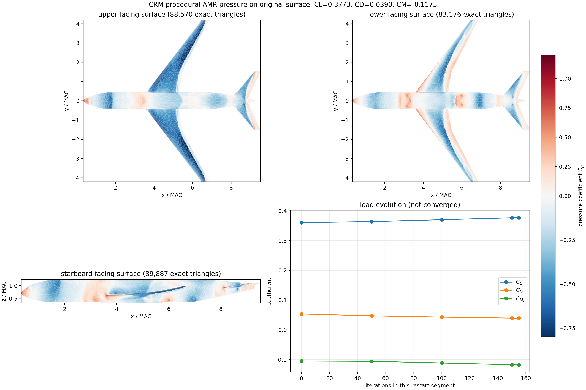
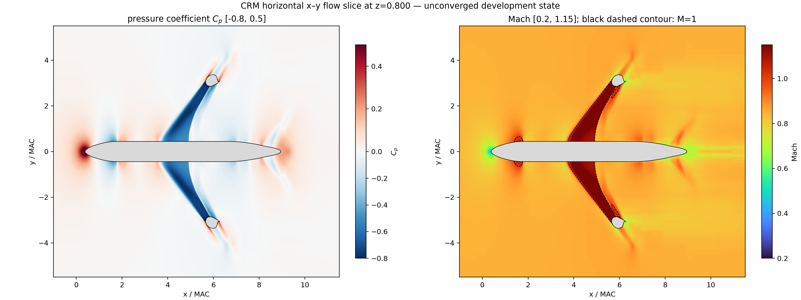
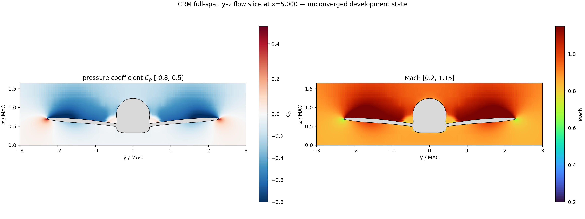
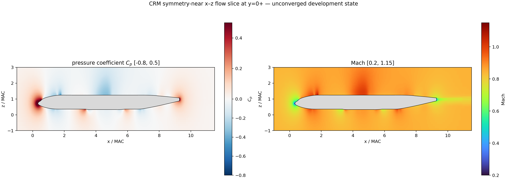
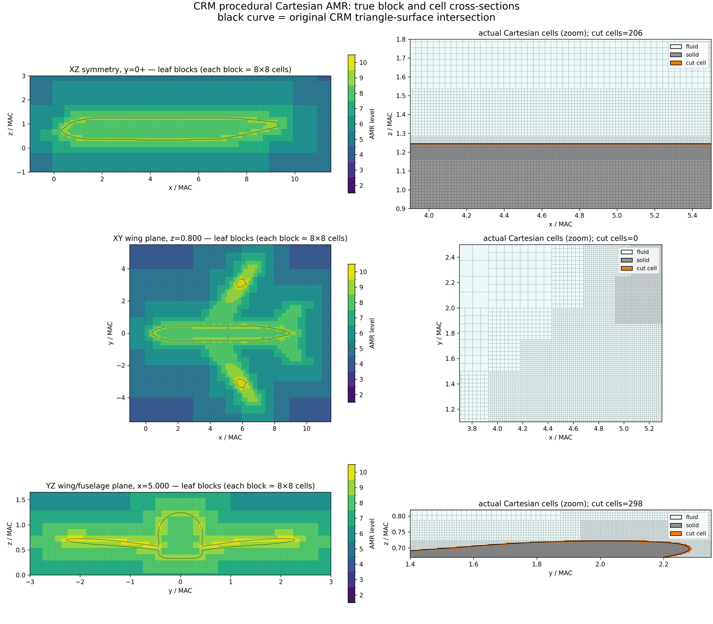

# Quick CFD: GPU-Accelerated Multi-Fidelity Compressible Flow Solver

**2D/3D compressible RANS/Euler solver on Cartesian AMR cut-cell, tetrahedral, hybrid, and polyhedral meshes, with CPU/OpenMP and CUDA backends (RK3 and DP-LUR) for aerodynamic load and surface pressure prediction.**

Quick CFD is a GPU-focused solver built to generate multi-fidelity compressible flow fields and aerodynamic trends for neural-network fidelity-lift and surrogate models (such as NNLCI). It includes a 3D procedural octree-AMR cut-cell solver for full aircraft configurations, an unstructured 3D explicit-face solver for general polyhedral and hybrid grids, and a 2D Cartesian cut-cell solver for airfoils. The repository provides the C++/CUDA and Python sources, mesh converters, example runbooks, and a theory manual.

**Verification and validation status:** Geometry closure, freestream preservation, density/pressure positivity, checkpoint restarts, and fixed-step CPU/CUDA bitwise or near-machine-precision parity are verified across the test suite. The 2D NACA 4412 case is validated against XFOIL. On the 3D NASA Common Research Model (CRM) 21.52M-cell octree-AMR grid, a 5,000-iteration run reaches wing surface $C_p$ RMSE of 0.1003 and late-window aerodynamic coefficients of $C_L = 0.5237$, $C_D = 0.0263$, $C_M = -0.0245$ (compared with NASA USM3D reference values of $0.5424 / 0.0300 / -0.0625$); damping of the remaining low-frequency pitching-moment oscillation is ongoing.


## 3D Full-Aircraft Showcase (NASA CRM, 21.52M Cells, Mach 0.85)

All aircraft surface and volume slices below are plotted directly on exact cut-wall triangles and procedural AMR control volumes without `scipy.interpolate.griddata` smoothing.

| Multi-view surface $C_p$ & load evolution | Horizontal wing slice ($z/\text{MAC} = 0.80$, $C_p$ & Mach) |
|---|---|
|  |  |
| **Full-span crossflow slice ($x/\text{MAC} = 5.0$, $C_p$ & Mach)** | **Near-symmetry slice ($y \to 0^+$, $C_p$ & Mach)** |
|  |  |
| **3D octree-AMR block & cut-cell cross-sections** | **Spanwise AMR leaf blocks & wing cut-cell zoom** |
|  |  |

## Benchmarks and GPU Throughput (RTX 4090)

Timings below were measured on a single NVIDIA RTX 4090 and reflect end-to-end process or solver wall-clock time over test cases from Mach 0.2 to 1.65:

| Case | Mach | Mesh size | Recorded GPU runtime | Status |
|---|---:|---:|---:|---|
| NASA CRM Cartesian AMR | 0.85 | 21,523,036 active cells (from 31.48M octree cells) | 3,722 continuation sweeps in 1,658.84 s (0.446 s/iter; 5,000 total) | Wing $C_p$ RMSE 0.1003 ($C_L = 0.5237$); low-frequency $C_M$ mode active |
| NASA CRM tetrahedral | 0.85 | 10,067,380 tetrahedra | 5,850 DP-LUR sweeps in 600.20 s (610.35 s total) | Unstructured 3D throughput test |
| 3D sphere regression | 1.65 | 7,680 polyhedral cells | 2.15 s total process time | Conservation and CPU/CUDA parity check ($10^{-15}$) |
| RAE 2822 hybrid LF1 | 0.78 | 5,051 wedge/hex cells | 49,000 DP-LUR sweeps in 11.24 s | Solver and CPU/CUDA parity verified |
| NACA 4412 LF1 / LF2 | 0.20 | 4,718 / 9,517 cells | 20.07 / 33.09 s total process time | $C_L$, $C_M$, and surface $C_p$ match XFOIL reference |

On the 21.52M-cell CRM AMR grid, five-sweep block-DP-LUR continuation runs at ~0.446 s per outer iteration (~0.408 s/iter with scalar neighbor coupling) on an RTX 4090. Over cumulative iterations 4,000–5,000, the iteration-averaged coefficients are $C_L = 0.523661$, $C_D = 0.026297$, and $C_M = -0.024508$ against NASA USM3D reference values of $0.54239 / 0.02995 / -0.06249$. Because these are local pseudo-time iterations and the 4,500–5,000 window still exhibits pitching-moment drift, the state is reported as an active development checkpoint rather than a steady converged solution. Building the full octree cut-cell mesh from the closed aircraft surface takes 8 min 52 s from scratch, or 5 min 20 s when refining from a cached parent grid.

## Mesh Representations

| Dim | Grid type | Application in this repo |
|---|---|---|
| 3D | Procedural multi-block octree AMR cut cells | $8\times 8\times 8$ leaf blocks with exact surface clipping, cell agglomeration, and 2:1 refinement interfaces |
| 3D | Explicit owner/neighbor polyhedral faces | Unstructured tetrahedra, prism/hex hybrid slabs, and 6-block cubed-sphere grids |
| 2D | Structured Cartesian & quadtree AMR cut cells | Multi-fidelity (LF1/LF2) airfoils with exact boundary segments and small-cell merging |

For the 3D octree AMR solver, regular interior block connectivity is evaluated procedurally on the fly; only block interfaces, physical boundaries, cut-face exceptions, and surface triangles are stored explicitly in device memory.

## Solver Paths

All solvers use a density-based finite-volume formulation (explicit RK3 or implicit DP-LUR) with low-Mach preconditioning for subsonic cases; pressure-based segregated schemes (SIMPLE/PISO) are not used.

| Path | Mesh topology | Discretization & time marching | Verification / validation |
|---|---|---|---|
| 3D CRM AMR | Multi-block octree cut cell | Procedural DP-LUR (scalar or $5\times 5$ block Euler action) | 7.66M, 14.01M, and 21.52M cell runs; 5,000-iter wing $C_p$ RMSE 0.1003 |
| 3D CRM tetra | Body-fitted unstructured tetrahedra | Explicit-face DP-LUR | 10.07M-cell import, checkpoint restart, gradient & SA tests |
| 3D sphere | 6-block cubed-sphere polyhedra | Explicit-face CPU/CUDA | Conservation, positivity, CPU/CUDA parity |
| 3D RAE 2822 | Mixed wedge/hex thin wing section | Explicit-face DP-LUR | LF1 run and CPU/CUDA parity |
| 2D airfoil | Cartesian cut cell (LF1/LF2) | Density-based, RK3, SA-neg, low-Mach preconditioning | Validated against XFOIL ($C_L, C_M, C_p$) on NACA 4412 |

## Build and Quick Start

CUDA build (defaults to `sm_89` for RTX 4090):

```bash
python3 -m venv .venv
source .venv/bin/activate
pip install -r requirements.txt
cmake -S . -B build -DCMAKE_BUILD_TYPE=Release -DCFD_CUDA=ON \
  -DCMAKE_CUDA_ARCHITECTURES=89
cmake --build build -j 8
ctest --test-dir build --output-on-failure
```

CPU-only build (OpenMP):

```bash
cmake -S . -B build_cpu -DCMAKE_BUILD_TYPE=Release \
  -DCFD_CUDA=OFF -DCFD_OPENMP=ON
cmake --build build_cpu -j 8
ctest --test-dir build_cpu --output-on-failure
```

Run the self-contained 3D supersonic sphere test case:

```bash
bash examples/3d_sphere/run_smoke.sh build_cpu cpu
```

## Additional 3D Unstructured & 2D Airfoil Gallery

Body-fitted 3D unstructured grids and 2D airfoil test cases included in the verification suite (full index in the [example showcase](examples/README.md#visual-showcase)):

| Body-fitted 3D CRM tetrahedral section | 3D cubed-sphere polyhedra ($M = 1.65$) |
|---|---|
|  |  |
| **Wedge/hex hybrid wing slab (RAE 2822)** | **2D quadtree AMR cut cells (NACA 4412)** |
|  |  |

## Documentation

- [Theory and operation manual](docs/MANUAL.md)
- [Development log and history](docs/DEVELOPMENT_HISTORY.md)
- [Example matrix and runbooks](examples/README.md)
- [Mesh and flow visual showcase](examples/README.md#visual-showcase)
- [Current verification & convergence status](docs/STATUS.md)
- [Binary and mesh file formats](docs/FORMATS.md)
- [References and external datasets](docs/REFERENCES.md)

## Repository Layout

- `solvers/` — [2D/3D solver executables and source map](solvers/README.md)
- `solvers/3d/` — Procedural-AMR `amr3d` and explicit-face `sphere3d` solvers, mesh importers, restart tools, and unit tests
- `tools/cartesian_amr/` — Octree builder, exact triangle-box clipping, cut-cell moments, cell agglomeration, and GPU table packing
- `tools/hybrid/` — 2D mixed tri/quad extrusion to 3D wedge/hex hybrid grids
- `src/`, `pipeline/`, `quick_cfd.py` — 2D `quick_airfoil` Cartesian cut-cell workflow
- `examples/` — Reproducible runbooks and configuration files for each test case
- `validation/` — Post-processing and reference comparison scripts

## External Meshes and License

Raw NASA CRM and RAE 2822 archive grids are not stored in the repository; the scripts under `examples/` document the download URLs, checksums, and conversion commands. See [LICENSE_NOT_SELECTED.md](LICENSE_NOT_SELECTED.md) regarding current licensing status.
