# Mesh Data Structures, Table Generation, and Reconstruction

This guide documents how 2-D and 3-D geometries are converted into finite-volume mesh tables, how each solver reads those tables on the CPU and GPU, and how cell, face, node, and AMR block records feed the flux and gradient operators.

## 1. Overview of Solver Mesh Routes

All three solver routes use table-driven finite-volume data structures on the host and copy flat arrays to GPU device memory before time marching:

| Route | Geometry / Volume Input | Preprocessing Pipeline | Solver Table Representation | Executable |
|---|---|---|---|---|
| **2-D Airfoil Cut-Cell AMR** | Ordered airfoil CSV (`x,y` or `x,y,patch`) | Built in-process by `quick_airfoil` (`static_amr2d_build`) and exported via `static_amr_binary_mesh` | In-memory CSR tables (`StaticAmrMesh2D`: `cells`, `faces`, `walls`, `face_offsets`, `reconstruction_terms`) + `.npy` / `.npz` exports | `quick_airfoil` (via `simple_airfoil.py` or `quick_cfd.py`) |
| **3-D Procedural Octree AMR** | Closed triangulated surface (`.npz` or `.stl`) | 7-stage `tools/cartesian_amr/` pipeline + `prepare_amr_wall_distance` | Packed binary directory (`QCFDAM1`: 13 binary tables for $8\times 8\times 8$ blocks, 2:1 interfaces, cut faces, wall fragments, and controls) | `amr3d` / `amr3d_cpu` |
| **3-D Explicit-Face Unstructured** | CGNS tetrahedral grid, 2-D extruded hybrid NPZ, or analytic sphere | `prepare_tetra`, `convert_rae2822_npz.py`, or `make_mesh.py` (+ `build_node_gradient`, `build_agglomeration`) | Packed `QCFD3D1` binary/text mesh (`Cell`, `Face`, CSR `ids`, gradient `Term`) + optional `QCFDNC1` / `QCFDNG1` / `QCFDMG1` companion tables | `sphere3d` / `sphere3d_cpu` |

```mermaid
flowchart TD
  subgraph R2D["2-D Quadtree AMR Cut-Cell Route"]
    A2["Airfoil CSV<br/>(x,y or x,y,patch)"] --> B2["pipeline/geometry.py<br/>airfoil.csv + patches.csv"]
    B2 --> C2["static_amr2d_build()<br/>Quadtree leaves + polygon clipping"]
    C2 --> D2["In-Memory CSR Tables (StaticAmrMesh2D)<br/>cells, faces, walls, face_offsets, reconstruction_terms"]
    D2 --> E2["CPU / Persistent CUDA Solver<br/>(RK3 or 4x4 Block DP-LUR)"]
    D2 --> F2["static_amr_binary_mesh() & export.py<br/>.npy / .npz tables for NNLCI"]
  end

  subgraph R3DAMR["3-D Procedural Octree AMR Route (QCFDAM1)"]
    A3["Closed Surface<br/>(.stl / .npz)"] --> B3["1. fast_surface_pipeline.py<br/>(column_plan.npz)"]
    B3 --> C3["2. build_octree_plan.py<br/>(octree_blocks.npz)"]
    C3 --> D3["3. build_interface_plan.py<br/>& 4. build_cut_cells.py"]
    D3 --> E3["5. build_cartesian_solver_tables.py<br/>& 6. pack_cartesian_amr.py"]
    E3 --> F3["7. prepare_amr_wall_distance<br/>Packed QCFDAM1 Directory (13 .bin tables)"]
    F3 --> G3["amr3d / amr3d_cpu<br/>Procedural 8x8x8 interiors + table exceptions"]
  end

  subgraph R3DUNS["3-D Unstructured & Hybrid Route (QCFD3D1)"]
    A4["NASA CGNS / Hybrid NPZ"] --> B4["prepare_tetra / convert_rae2822_npz.py"]
    B4 --> C4["mesh.bin (QCFD3D1)<br/>Cell, Face, CSR ids, WLS Term"]
    B4 --> D4["connectivity.bin (QCFDNC1)<br/>Nodes, Tet-Node CSR"]
    D4 --> E4["build_node_gradient<br/>node_gradient.bin (QCFDNG1)"]
    C4 --> F4["sphere3d / sphere3d_cpu"]
    E4 --> F4
  end
```



---

## 2. Two-Dimensional Airfoil AMR Cut-Cell Tables (`StaticAmrMesh2D`)

### 2.1 How the 2-D mesh and tables are built
When `quick_airfoil` starts, it reads the ordered airfoil polygon (`airfoil.csv` and `patches.csv`) and builds a multi-level Cartesian quadtree mesh directly in memory via `static_amr2d_build` (`src/static_amr2d.cpp`):

1. **Quadtree subdivision**: Starts from a root Cartesian grid (`nx` $\times$ `ny` over `[xmin, xmax] x [ymin, ymax]`), refines nested boxes (`LF1` or `LF2` levels) with a 2:1 buffer zone, and retains only active leaf cells.
2. **Exact polygon clipping (`cut2d_rect_metrics`)**: Clips the airfoil polygon against each leaf rectangle $[x_0, x_1]\times[y_0, y_1]$ to compute fluid area (`volume`), fluid centroid $(c_x, c_y)$, open Cartesian face apertures, and clipped wall segments (`WallFragment2D`). Disconnected fluid pockets inside a single background leaf are split into separate finite-volume control volumes (`leaf_components`).
3. **Small-cell agglomeration (optional)**: Merges tiny cut cells into neighboring fluid cells and records the mapping in `group_offsets`, `group_members`, and `agglomeration`.
4. **CSR table assembly**: Constructs flat Compressed Sparse Row (CSR) lookup tables for cell-to-face adjacency, least-squares gradient stencils, viscous face stencils, and optional wall-normal pressure probes.

### 2.2 In-memory C++ and GPU table layout (`src/static_amr2d.h`)
The 2-D solver stores all mesh connectivity and geometry in `StaticAmrMesh2D` and uploads those flat arrays once to GPU device memory (`StaticAmrGpuSession` in `src/static_amr2d_cuda.cu`):

```cpp
struct AmrCell2D {
  int ix, iy, span, level;
  double x0, x1, y0, y1, volume, cx, cy;
  size_t wall_begin, wall_count;
};

struct AmrFace2D {
  int left, right, axis, boundary; // right = -1 on domain boundary; normal points along +axis
  double coordinate, lo, hi, length, centroid;
};

struct AmrReconstructionTerm2D {
  int neighbor;
  double x, y; // Preassembled weighted least-squares (WLS) gradient weights
};
```

| Table in `StaticAmrMesh2D` | Role in the Solver |
|---|---|
| `cells` (`AmrCell2D[N]`) | Active fluid/cut leaf control volumes, bounding boxes, fluid areas, centroids $(c_x, c_y)$, and slice `[wall_begin, wall_begin + wall_count)` into `walls`. |
| `faces` (`AmrFace2D[Nf]`) | One entry per shared fluid subface (including 1:1 and 2:1 coarse-fine interfaces), storing `left` owner, `right` neighbor, open aperture `length`, and `centroid`. |
| `walls` (`WallFragment2D[Nw]`) | Exact clipped airfoil segments inside cut cells (segment endpoints, normal, length, patch ID, wall distance). |
| `face_offsets`, `cell_faces` | CSR cell-to-face adjacency table: cell $i$ owns/touches faces `cell_faces[face_offsets[i] .. face_offsets[i+1]-1]`. |
| `reconstruction_offsets`, `reconstruction_terms` | CSR table of precomputed weighted least-squares (WLS) gradient coefficients $(w_{ik}^x, w_{ik}^y)$ for each cell's neighbor stencil. |
| `viscous` (`AmrViscousTable2D`) | Precomputed face-normal distances, cell-gradient interpolation weights, and wall shear/traction geometry. |
| `u` (`StaticAmrState2D`) | Flow state stored in Structure-of-Arrays (SoA) layout `u[var * N + cell]` for coalesced GPU memory access across $(\rho, \rho u, \rho v, \rho E, \rho\tilde\nu)$. |

### 2.3 Binary `.npy` / `.npz` table export for NNLCI
After solving (or in `--mode mesh`), `static_amr_binary_mesh` (`src/static_amr2d_binary.cpp`) and `pipeline/export.py` write machine-readable NumPy `.npy` / `.npz` and CSV tables under `<run>/<LF1|LF2>/output/`, including cell centroids, volumes, bounding boxes, wall surface $C_p / C_f$ distributions, and dimensional SI flow fields.

---

## 3. Three-Dimensional Unstructured Mesh Tables (`QCFD3D1`, `QCFDNC1`, `QCFDNG1`, `QCFDMG1`)

### 3.1 Source connectivity versus solver face tables
An imported 3-D volume mesh starts with **nodes** (point coordinates) and **elements** (tetrahedra, wedges, hexahedra, or general polyhedra). Rather than traversing element-to-node lists during every iteration, preprocessing converts the mesh into an explicit **owner/neighbor face table** (`QCFD3D1`) and precomputes all geometric weights.

To build the complete set of unstructured tables from a NASA CGNS file:

```bash
# 1. Convert CGNS tetrahedra into QCFD3D1 (mesh.bin) + QCFDNC1 (connectivity.bin)
./build/solvers/3d/prepare_tetra input.cgns mesh.bin connectivity.bin

# 2. (Optional) Precompute QCFDNG1 node-gradient weights (node_gradient.bin)
./build/solvers/3d/build_node_gradient connectivity.bin mesh.bin node_gradient.bin 16 audit.json hybrid

# 3. (Optional) Precompute QCFDMG1 coarse agglomeration hierarchy
./build/solvers/3d/build_agglomeration --mesh mesh.bin --out agglomeration_3level.bin --levels 3 --merges-per-level 2
```

For RAE 2822 mixed wedge/hexahedral grids, `tools/hybrid/convert_rae2822_npz.py` converts the archived 2-D extruded topology directly into `QCFD3D1`.

### 3.2 Face orientation and CSR neighbor lookup
Each `Face` record in `QCFD3D1` stores:

| Field | Meaning |
|---|---|
| `left` | Owner cell index (always $\ge 0$) |
| `right` | Neighbor cell index for an interior face; negative ($< 0$) for a boundary face |
| `bc` | Boundary-condition code when `right < 0` (`1` = no-slip wall, `2` = farfield, `3` = symmetry) |
| `x[3]` | Face centroid coordinates $(x_f, y_f, z_f)$ |
| `n[3]` | Unit normal vector $\boldsymbol{n}$ pointing outward from `left` toward `right` (or outward to the boundary) |
| `area` | Face area $A_f$ |
| `distance` | Orthogonal/projected distance between owner and neighbor centroids (or owner to boundary) |

For each interior face, the solver evaluates a single numerical flux $\boldsymbol{F}$ oriented along $\boldsymbol{n}$, adds $+\boldsymbol{F} A_f$ to the `left` (owner) residual, and subtracts $-\boldsymbol{F} A_f$ from the `right` (neighbor) residual:

```text
cell 12 (left / owner)  ---- face 87, normal n, area A ---->  cell 29 (right / neighbor)
      residual += F * A                                             residual -= F * A
```

To iterate over all faces touching cell $i$ (for gradients or implicit DP-LUR sweeps), the solver indexes the flat CSR array `ids` over `[Cell[i].first, Cell[i].first + Cell[i].count)`.

### 3.3 `QCFD3D1` binary record layout (`solvers/3d/mesh_format.h`)
A binary `QCFD3D1` file begins with a 48-byte `MeshHeader` (`QCFD3D1\0` magic, version `1`, endian marker `0x01020304`, and 64-bit counts `cells`, `faces`, `ids`, `terms`), followed immediately by four contiguous binary arrays:

1. `Cell[cells]` (64 bytes per cell)
2. `Face[faces]` (64 bytes per face)
3. `int32_t ids[ids]` (cell-to-face CSR index table)
4. `Term[terms]` (32 bytes per WLS gradient stencil entry)

```cpp
struct MeshHeader {
  char magic[8];           // "QCFD3D1\0"
  uint32_t version;        // 1
  uint32_t endian;         // 0x01020304
  uint64_t cells, faces, ids, terms;
};

struct Cell {
  double x[3], volume, dwall;
  int first, count, term_first, term_count;
};

struct Face {
  int left, right, bc;
  double x[3], n[3], area, distance;
};

struct Term {
  int source, face;
  double coefficient[3];
};
```

In `solvers/3d/solver.cu`, the loader inspects the first 8 bytes: if they match `QCFD3D1`, it reads the four binary arrays directly with `fread`; otherwise it parses the equivalent whitespace-delimited text format. In CUDA mode, those arrays are copied once to device global memory.

### 3.4 Gradients and second-order face reconstruction
The default cell-centered weighted least-squares (WLS) gradient uses the preassembled `Term` CSR slice `[Cell[i].term_first, Cell[i].term_first + Cell[i].term_count)`. Each `Term` specifies a neighbor cell $k$ (`source`) and a precomputed vector weight $\boldsymbol{c}_{ik}$ (`coefficient[3]`):

$$\nabla q_i \approx \sum_{k \in \mathcal{S}(i)} \boldsymbol{c}_{ik}\,(q_k - q_i)$$

When `--gradient node` is enabled on tetrahedral meshes, the solver loads two companion binary tables:
- **`QCFDNC1` (`connectivity.bin`)**: Stores `points[Np][3]`, `cell_nodes[Nc][4]`, the reverse node-to-cell CSR table (`node_offsets`, `node_cells`), and `boundary` triangles.
- **`QCFDNG1` (`node_gradient.bin`)**: Stores adaptive pseudo-Laplacian cell-to-node weights `node_weights`, exact tetrahedral linear shape-function gradients `cell_gradients[Nc][4][3]`, and face-node triples `face_nodes[Nf][3]` for the Mitchell viscous diffusion stencil.

For second-order mean-flow convection (`--spatial-order 2`), primitive variables $q = (\rho, u, v, w, p)$ are reconstructed from cell centroid $\boldsymbol{x}_i$ to face centroid $\boldsymbol{x}_f$:

$$q_{i,f} = q_i + \beta\,\phi_i\,\nabla q_i \cdot (\boldsymbol{x}_f - \boldsymbol{x}_i)$$

where $\beta \in [0, 1]$ is the reconstruction blend (`--order2-blend`) and $\phi_i \in [0, 1]$ is the Barth–Jespersen slope limiter computed across all faces of cell $i$ so $q_{i,f}$ never overshoots local neighbor extrema. Positivity guards enforce $\rho_{i,f} > 0$ and $p_{i,f} > 0$ before passing the left and right states $(q_{L,f}, q_{R,f})$ to the HLLC Riemann solver.

---

## 4. Three-Dimensional Procedural Octree-AMR Cut-Cell Tables (`QCFDAM1`)

### 4.1 Seven-stage pipeline from closed surface to `QCFDAM1` tables
Unlike `QCFD3D1`, the 3-D Cartesian AMR solver (`amr3d`) starts from a closed triangulated surface (`.stl` or `.npz`) and builds a factorized octree mesh where every leaf block is an $8\times 8\times 8$ uniform Cartesian grid ($512$ procedural cells per block).

The pipeline in `tools/cartesian_amr/` (automated by `examples/3d_crm_amr/build_meshes.sh`) builds the tables in 7 sequential stages:

| Stage | Tool / Executable | Generated Artifact / Table | Purpose |
|---:|---|---|---|
| 1 | `fast_surface_pipeline.py` | `column_plan.npz` | Validates watertightness/orientation and builds spatial surface acceleration columns. |
| 2 | `build_octree_plan.py` (or `refine_octree_upper_wing.py`) | `octree_blocks.npz` | Generates 2:1 balanced octree leaf blocks ($8\times 8\times 8$ cells each) around the body and shock region. |
| 3 | `build_interface_plan.py --surface-layer wall` | `interface_plan/` | Clips surface triangles against Cartesian cells and classifies every procedural cell as fluid, solid, or cut. |
| 4 | `build_cut_cells.py --surface-layer wall` | `cut_cells/` | Integrates exact clipped polyhedral fluid volumes, centroids, open face apertures, wall fragments, and merges small cut cells into agglomerated control volumes. |
| 5 | `build_cartesian_solver_tables.py` | `solver_tables/` | Assembles block-to-block interfaces (1:1 and 2:1), external boundary sides, procedural-to-control ID maps, and cut-face exception lists. |
| 6 | `pack_cartesian_amr.py` | `packed/` (`QCFDAM1` directory) | Writes the versioned little-endian binary tables consumed by `amr3d`. |
| 7 | `prepare_amr_wall_distance` | `packed/wall_distance.bin` | Builds an AABB bounding-volume hierarchy (BVH) over source triangles and writes exact wall distances for all active control volumes. |

### 4.2 What the `QCFDAM1` directory stores and how `amr3d` reads it
A `QCFDAM1` directory contains `header.bin` (112 bytes) plus 12 binary/text tables. When `amr3d` starts (`load_exact` in `solvers/3d/amr_solver.cu`), it validates `header.bin`, reads every binary table into host `std::vector` containers, and copies them once to GPU device buffers:

```cpp
struct AmrMeshHeader {
  char magic[8]; // "QCFDAM1\0"
  uint32_t version, endian, block_cells, reserved; // block_cells = 8
  uint64_t block_count, procedural_cell_count, control_count;
  uint64_t interface_count, boundary_side_count, cut_face_count, wall_face_count;
  double root_low[3], root_size;
}; // 112 bytes

struct AmrBlock {
  double low[3], spacing;
  int32_t fine_coordinate[3], fine_span, first_procedural;
  int16_t level;
  uint8_t kind, padding;
}; // 56 bytes

struct AmrBlockInterface {
  int32_t first_block, second_block;
  uint8_t first_side;
  int8_t level_difference; // 0 for same-level (1:1), +1/-1 for coarse-fine (2:1)
  uint8_t padding[2];
}; // 12 bytes

struct AmrControl {
  double x[3], volume, dwall;
}; // 40 bytes
```

| File in `QCFDAM1` Directory | Element Count | Data Stored & How Kernels Use It |
|---|---:|---|
| `header.bin` | 1 (`112 B`) | `AmrMeshHeader` with magic `"QCFDAM1\0"`, endian check, root domain box, and exact record counts for all tables below. |
| `blocks.bin` | `block_count` | `AmrBlock` records (`56 B` each): block origin `low[3]`, cell `spacing` $h$, octree `level`, and `first_procedural` index (`512 * block_id`). |
| `procedural_control.bin` | `512 * block_count` | `int32_t` lookup table mapping every procedural voxel $(b, i, j, k)$ to its active agglomerated solver control ID $c \in [0, \text{control\_count})$, or $-1$ if inside the solid body. |
| `procedural_status.bin` | `512 * block_count` | `uint8_t` flags indicating whether a procedural cell is regular fluid, cut by the wall, or part of an agglomerated group (`cut_faces` overrides apply). |
| `controls.bin` | `control_count` | `AmrControl` records (`40 B` each): true fluid centroid $(x, y, z)$, fluid volume $V_c$, and wall distance $d_{\text{wall}}$ for each active finite-volume unknown. |
| `interfaces.bin` | `interface_count` | `AmrBlockInterface` records (`12 B` each): pairs of face-adjacent blocks (`first_block`, `second_block`), face direction `first_side` $\in [0,5]$, and `level_difference` ($0$ for $8\times 8$ matching faces, $\pm 1$ for $2:1$ coarse-fine interfaces split into four fine subfaces). |
| `boundaries.bin` | `boundary_side_count` | `AmrBoundarySide` records (`8 B` each): outer domain block faces where farfield boundary conditions apply. |
| `cut_faces.bin` | `cut_face_count` | Explicit open Cartesian face apertures where a cell is clipped by the wall or merged by agglomeration (owner/neighbor control IDs, centroid, normal, partial area). |
| `wall_faces.bin` | `wall_face_count` | Clipped solid-wall polygon fragments (adjacent fluid control ID, fragment centroid, unit normal $\boldsymbol{n}_{f\to s}$ into solid, area $A_w$, and wall distance). |
| `wall_triangle.bin` | `wall_face_count` | `int32_t` index mapping each clipped wall fragment back to its parent triangle on the input aircraft surface. |
| `wall_distance.bin` | `control_count` | `float64` exact BVH nearest-surface distance per active control volume (used by the SA-neg destruction term). |
| `wall_counts.txt`, `wall_points.bin`, `wall_triangles.bin` | surface counts | Original triangulated aircraft surface vertices and triangles used for aggregating fragment forces into per-triangle `surface.csv` exports and 3-D visualization. |

### 4.3 Why regular block faces do not need a face table
In a 21.52M-cell mesh, storing three explicit Cartesian faces per cell would consumeseveral gigabytes of GPU memory and memory bandwidth. Instead, `amr3d` evaluates interior faces of each $8\times 8\times 8$ leaf block **procedurally on the fly** (`procedural_face` in `solvers/3d/amr_solver.cu`):

1. Given block index $b$ and local voxel indices $(i, j, k) \in [0, 7]^3$, the face centroid and area $h^2$ follow immediately from `block.low` and `block.spacing`.
2. The kernel looks up the left and right procedural cells in `procedural_control.bin` to obtain their active control volume IDs $(c_L, c_R)$.
3. If either cell is solid ($< 0$), if $c_L == c_R$ (internal face inside an agglomerated control), or if `procedural_status.bin` marks the face as a cut-cell exception, the procedural kernel skips it; the exact clipped geometry is handled instead by the `cut_faces.bin` and `wall_faces.bin` kernels.

### 4.4 Green–Gauss gradients, wall pressure, and DP-LUR on `QCFDAM1`
During each residual evaluation on the AMR mesh:

1. **Green–Gauss cell gradients**: Procedural block faces, 1:1 and 2:1 block interfaces, cut-face exceptions, and boundary faces accumulate area-weighted primitive states onto each control volume, yielding the Green–Gauss gradient:

$$\nabla q_c = \frac{1}{V_c} \sum_{f \in \partial \Omega_c} \hat{q}_f\,\boldsymbol{n}_f\,A_f$$

2. **Limited second-order face states**: At every interior face (procedural, 1:1, 2:1 subface, or cut face), left and right primitive states are reconstructed from control centroids $\boldsymbol{x}_c$ to the exact face/subface centroid $\boldsymbol{x}_f$:

$$q_{c,f} = q_c + \beta\,\phi_c\,\nabla q_c \cdot (\boldsymbol{x}_f - \boldsymbol{x}_c)$$

3. **Wall pressure and aerodynamic load integration**: Each clipped wall fragment in `wall_faces.bin` stores its exact area $A_w$, centroid $\boldsymbol{x}_w$, and unit normal $\boldsymbol{n}_{f\to s}$ pointing from fluid into solid. Wall pressure $p_w$ is reconstructed to $\boldsymbol{x}_w$, and pressure force is integrated fragment by fragment:

$$\boldsymbol{F}_p = \sum_{w} p_w\,\boldsymbol{n}_{f\to s,w}\,A_w$$

4. **Implicit DP-LUR relaxation**: The six conserved variables $Q = (\rho, \rho u, \rho v, \rho w, \rho E, \rho\tilde\nu)^T$ are advanced in local pseudo-time by sweeping over neighbors using either scalar spectral radii or the opt-in $5\times 5$ matrix-free Euler normal-flux Jacobian action (`--dplur-block-coupling 1`).

---

## 5. Related Format and Operation References

- [`docs/FORMATS.md`](FORMATS.md) — Compact summary of `QCFD3D1`, `QCFDNC1`, `QCFDNG1`, `QCFDMG1`, `QCFDAM1`, and `state.bin`.
- [`docs/INSTALL_AND_RUN.md`](INSTALL_AND_RUN.md) — End-to-end compilation and execution commands for all 2-D and 3-D routes.
- [`solvers/3d/mesh_format.h`](../solvers/3d/mesh_format.h) & [`solvers/3d/amr_mesh_format.h`](../solvers/3d/amr_mesh_format.h) — Exact C++ binary struct declarations and `static_assert` byte sizes.
- [`tools/cartesian_amr/NNLCI_BINARY_FORMAT.md`](../tools/cartesian_amr/NNLCI_BINARY_FORMAT.md) — Experimental memory-mapped `.npy` prism/octree table format (`QCFD_NNLCI_MESH_TABLES`) and `nnlci_table_reader.py`.
